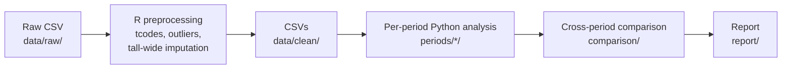

# FRED-MD factor-model forecasting

Group project (4 people) on forecasting US macro series with factor models
estimated from the FRED-MD database. Each person analyses one time period;
everyone uses the same data, loaded through `src/common.py`.

## Shared code

`src/common.py` currently only handles loading the data (`load_tcode`,
`load_clean`, `load_transformed`), period slicing (`slice_period`) and the
outlier rule (`iqr_outliers`). Shared methods should be added once the group
agrees on them, via a pull request.

## Pipeline



## Repo layout

```
data/raw/              FRED-MD vintage as downloaded
data/clean/            tcode, transformed and clean panels (see Outputs)
R/preprocess.R         raw -> clean
src/common.py          shared data loading, period slicing, outlier rule
tests/                 checks for src/ (python tests/test_iqr_outliers.py)
periods/_template/     starting point for a new period
periods/<period>/      one folder per period: analysis.ipynb + results/
comparison/            cross_period.ipynb (placeholder until a results format is agreed)
report/                LaTeX report (sections/ for each part)
output/                tables written by scripts
figures/               plots
```

## Setup

R (preprocessing): open `FRED-MD.Rproj` in RStudio, then

```r
install.packages(c("here", "remotes"))
remotes::install_github("cykbennie/fbi")
source("R/preprocess.R")
```

The vintage is set by `VINTAGE` at the top of the script. It writes to
`data/clean/`, `output/` and `figures/`.

Python (analysis):

```bash
python -m venv .venv
source .venv/bin/activate
pip install -r requirements.txt
jupyter notebook
```

## Data

Source: FRED-MD vintage `2026-09` (`data/raw/2026-09-MD.csv`), each series
transformed to stationarity with its McCracken & Ng tcode. After dropping the
2 months lost to differencing the panel runs 1959-03 to 2026-08:
T = 810 months, N = 126 series.

Outliers reflect real events, so we do not remove them by default;
data/clean applies a full-sample 10 x IQR rule and full-sample imputation and
is not used for forecasting.

### Outputs

`R/preprocess.R` writes three panels to `data/clean/`. They have identical
headers (`date` + series names) and identical rows.

| File | Contains | Use for |
|---|---|---|
| `fredmd_tcode_<vintage>.csv` | tcode transform only. No outlier removal, NAs kept (incl. ragged edge). | **Forecasting.** Apply outlier rules and imputation inside each estimation window. |
| `fredmd_transformed_<vintage>.csv` | tcode + **full-sample** 10 x IQR outlier removal (outliers set to NA). NAs kept. | Legacy only. The outlier thresholds use future data. |
| `fredmd_clean_<vintage>.csv` | As transformed, plus **full-sample** tall-wide (`tw_apc`) imputation. No NAs. | Exploration and plots only. |

The R run also writes `output/missing_by_decade.csv` and
`figures/missing_heatmap.png`.

### Loading in Python

```python
from src.common import load_tcode, slice_period, iqr_outliers

df = slice_period(load_tcode(), "2005-2015")    # NAs kept, no outliers removed

# Sensitivity check only: 10 x IQR rule using the window's own data
df_no_outliers = iqr_outliers(df, k=10)
```

`iqr_outliers` matches `fbi::rm_outliers.fredmd` exactly when given the same
data: 165 outliers on the full sample (see `tests/test_iqr_outliers.py`).

### Ragged edge

The final month, 2026-08, has 10 of the 126 series missing because they
had not been published yet: CMRMTSPLx, ACOGNO, BUSINVx, ISRATIOx, NONREVSL,
CONSPI, S&P div yield, S&P PE ratio, DTCOLNVHFNM, DTCTHFNM. To drop it, set
`DATE_END <- as.Date("2026-07-01")` in `R/preprocess.R` and rerun, or in
Python use `df.loc[:"2026-07"]`. `preprocess.R` prints the count and names
for whichever vintage it runs on.

### Caveats

- Look-ahead: `data/clean/fredmd_clean_*` (and the outlier removal in
  `fredmd_transformed_*`) are estimated on the full 1959-2026 sample, so they
  use future information. They are **not** used for forecasting. Forecasts
  start from `fredmd_tcode_*`, and outlier handling and imputation happen
  inside each estimation window, using only data available at the forecast
  origin.

### Key terms

| Symbol | Meaning |
|---|---|
| T | number of months (time periods) |
| N | number of series |
| r | number of static factors (q is reserved for dynamic factors) |
| h | forecast horizon, in months |
| t | forecast origin (last month used for estimation) |
| X_t | N x 1 vector of the series in month t |
| F_t | r x 1 vector of static factors in month t |
| Λ (Lambda) | N x r matrix of factor loadings |
| e_t | N x 1 idiosyncratic component: X_t = Λ F_t + e_t |

## Starting a new period

1. Copy `periods/_template/` to `periods/<start>-<end>/`, e.g. `periods/1985-2004/`.
2. Add the period to `PERIODS` in `src/common.py` (via a pull request).
3. Set `PERIOD` in the first cell of your `analysis.ipynb` to the same name.

## Group rules

- Work freely in your own `periods/<period>/` folder.
- Changes to `src/` or `data/clean/` go through a pull request, so everyone
  keeps using the same code and data.
- Settings marked `# PROPOSAL: to be agreed by the group` in `src/common.py`
  are provisional until the group signs off.
