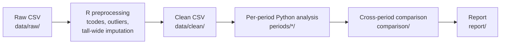

# FRED-MD factor-model forecasting

Group project (4 people) on forecasting US macro series with factor models
estimated from the FRED-MD database. Each person analyses one time period;
everyone uses the same cleaned data, loaded through `src/common.py`.

## Shared code

`src/common.py` currently only handles loading the data (`load_clean`,
`load_transformed`) and period slicing (`slice_period`). Shared methods
should be added once the group agrees on them, via a pull request.

## Pipeline



## Repo layout

```
data/raw/              FRED-MD vintage as downloaded
data/clean/            transformed (with NAs) and imputed (clean) panels
R/preprocess.R         raw -> clean
src/common.py          shared data loading and period slicing
periods/_template/     starting point for a new period
periods/<period>/      one folder per period: analysis.ipynb + results/
comparison/            cross_period.ipynb (placeholder until a results format is agreed)
report/                LaTeX report (sections/ for each part)
output/                tables written by scripts
figures/               plots
```

## Setup

R (preprocessing): open `FRED-MD.Rproj` in RStudio, then

```r
install.packages(c("here", "remotes"))
remotes::install_github("cykbennie/fbi")
source("R/preprocess.R")
```

The vintage is set by `VINTAGE` at the top of the script. It writes to
`data/clean/`, `output/` and `figures/`.

Python (analysis):

```bash
python -m venv .venv
source .venv/bin/activate
pip install -r requirements.txt
jupyter notebook
```

## Starting a new period

1. Copy `periods/_template/` to `periods/<start>-<end>/`, e.g. `periods/1985-2004/`.
2. Add the period to `PERIODS` in `src/common.py` (via a pull request).
3. Set `PERIOD` in the first cell of your `analysis.ipynb` to the same name.

## Group rules

- Work freely in your own `periods/<period>/` folder.
- Changes to `src/` or `data/clean/` go through a pull request, so everyone
  keeps using the same code and data.
- Settings marked `# PROPOSAL: to be agreed by the group` in `src/common.py`
  are provisional until the group signs off.
